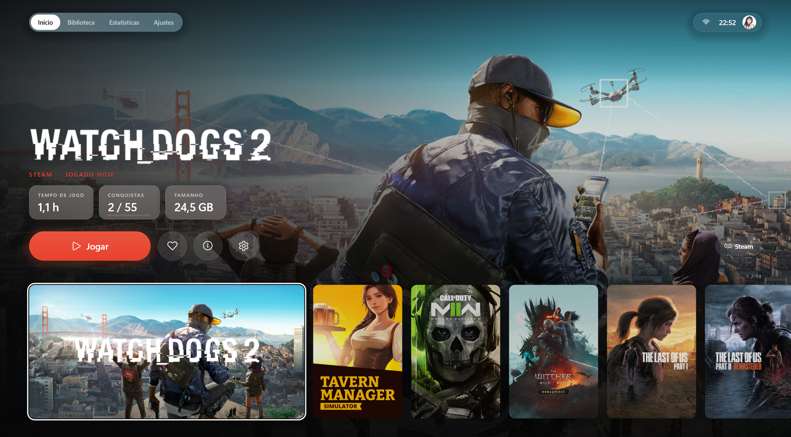
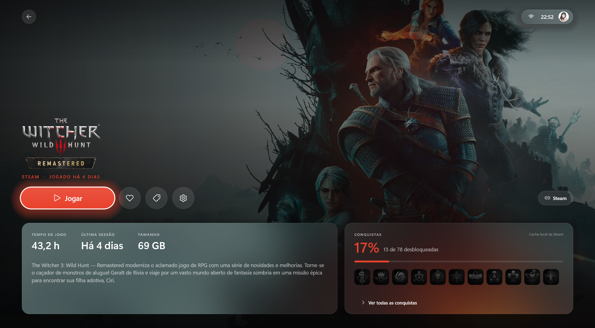
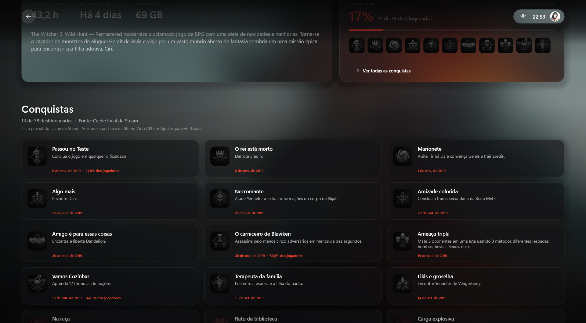
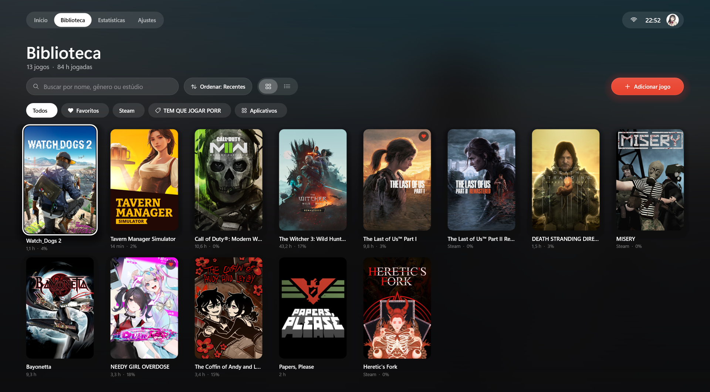
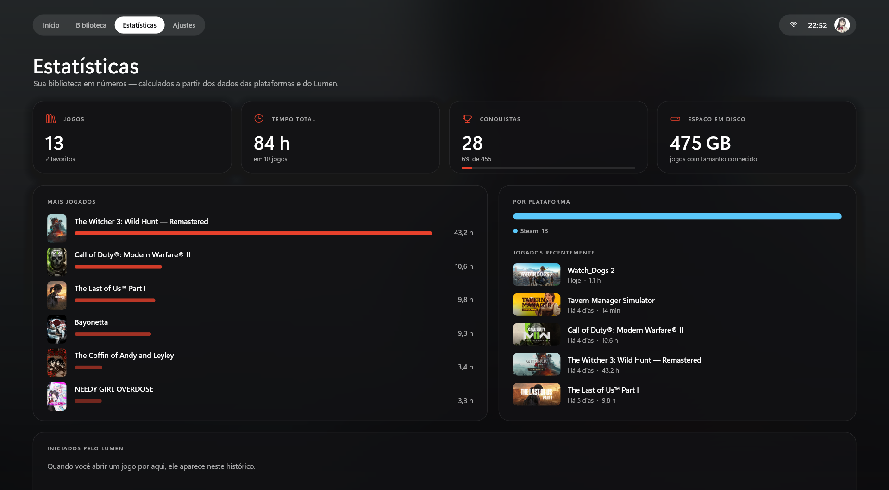
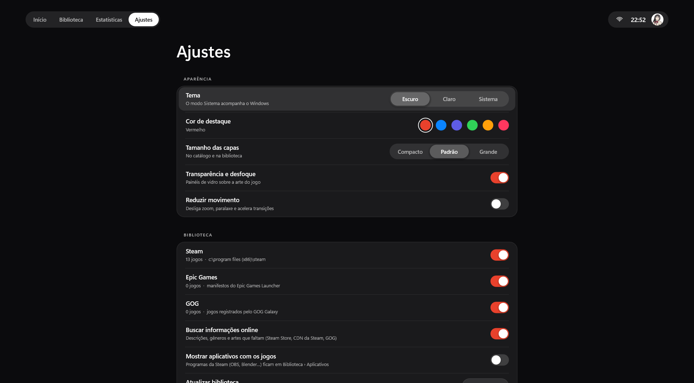
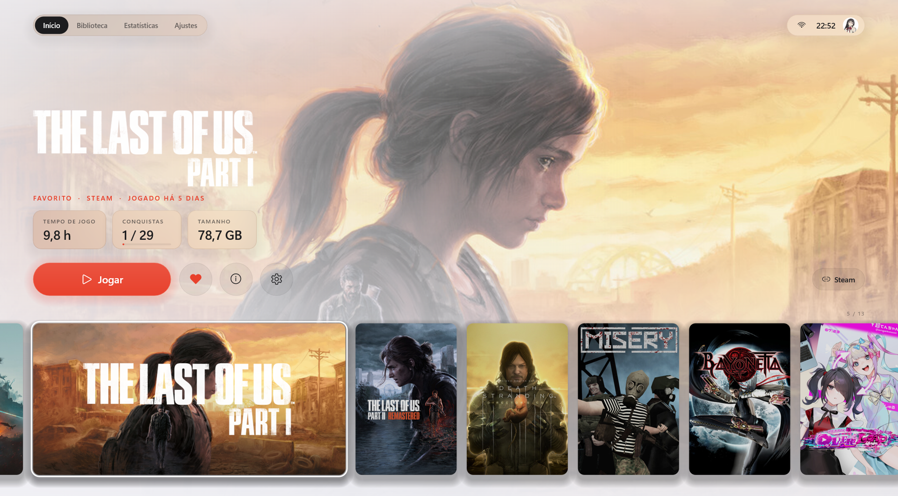

# Lumen

**Sua biblioteca de jogos do PC num lugar só, com interface morderna.**

O Lumen encontra sozinho os jogos instalados da **Steam, Epic Games e GOG**, junta tudo num catálogo bonito
com capas, trailers no fundo, conquistas reais e tempo de jogo, e abre qualquer jogo com um clique.
Um único `.exe` de ~1 MB, sem instalar nada.



| Página do jogo | Conquistas |
|---|---|
|  |  |

| Biblioteca | Estatísticas |
|---|---|
|  |  |

| Ajustes | Tema claro |
|---|---|
|  |  |

---

## Baixar e usar

1. Baixe o **`Lumen-1.0-win64.zip`**.
2. Extraia para uma pasta qualquer (ex.: `Documentos\Lumen`). Não rode de dentro do zip.
3. Abra o **`Lumen.exe`**. Pronto: seus jogos aparecem sozinhos.

**Requisitos:** Windows 10 ou 11, 64 bits. Não precisa de .NET nem de Visual C++ Redistributable.

### "O Windows protegeu o computador"
O Lumen ainda não tem assinatura digital paga, então o SmartScreen pode avisar na primeira vez.
Clique em **Mais informações → Executar assim mesmo**. Só acontece uma vez.

---

## O que ele faz

**Biblioteca**
- Detecta Steam (todas as bibliotecas), Epic Games Launcher e GOG Galaxy automaticamente.
- Qualquer outro jogo: botão **Adicionar jogo**, `Ctrl+N` ou **arraste o `.exe` para a janela**.
- Busca (nome, gênero, estúdio, ignorando acentos), favoritos, categorias próprias, coleções da Steam, ocultar jogos.
- Ordenar por recentes, nome, tempo de jogo ou data de adição. Ver como catálogo horizontal, grade ou lista.
- Status de cada jogo: **Na fila, Jogando, Zerado, Abandonado**, com filtros. Notas pessoais por jogo.
- Programas da Steam (OBS, Blender…) ficam separados dos jogos.

**Página do jogo**
- Capa, fundo e logo oficiais; dá para trocar soltando uma imagem na página.
- **Trailer oficial tocando sem som no fundo**, arte que "respira", luz ambiente na cor do jogo.
- **Conquistas reais** (nunca inventadas), tempo de jogo, novidades oficiais da Steam e suas capturas de tela (F12).
- Botão **Jogar** com animação de abertura.

**Acompanhamento**
- Estatísticas: tempo total, mais jogados, por plataforma, histórico e um calendário de atividade do ano.
- Meta diária de jogo, contagem de "jogados hoje" e sequência de dias.
- **Avisos do Windows** enquanto você joga (a cada 30 min, 1 h ou 2 h) e um resumo no fim da sessão.
- Comemoração quando você desbloqueia conquistas ou bate marcos de horas (10, 25, 50, 100 h…).

**Ofertas**
- Promoções da Green Man Gaming, Instant Gaming e Driffle num lugar só, com desconto, preço atual e antigo,
  filtro por loja e selo "na sua biblioteca". Nuuvem e Eneba aparecem como atalhos para o site.

**Jeito de usar**
- Tema escuro, claro ou do sistema; 6 cores de destaque ou a cor do jogo selecionado.
- **Tela cheia** (F11), suporte a **controle de Xbox**, tela cheia automática ao conectar um controle.
- Modo vitrine: parado por 45 s, o Início passa pelos jogos sozinho.
- "Surpreenda-me" (`R`): sugere um jogo pouco jogado da sua biblioteca.
- Iniciar com o Windows, sons de interface (desligáveis), perfil no avatar com resumo do dia.

## Atalhos

| Ação | Teclado | Controle |
|---|---|---|
| Navegar | Setas | D-pad / analógico |
| Abrir jogo · Jogar | Enter | A |
| Voltar | Esc | B |
| Página do jogo | I | Y |
| Favoritar | F | X |
| Opções do jogo | M · clique direito | Start |
| Pular 5 jogos | Page Up / Page Down | LB / RB |
| Buscar | Ctrl+F · / · digitar na Biblioteca | — |
| Trocar de seção | Tab · Ctrl+1…5 | View |
| Adicionar jogo | Ctrl+N | — |
| Atualizar biblioteca | F5 | — |
| Surpreenda-me | R | — |
| Tela cheia | F11 · Alt+Enter | — |

---

## Perguntas frequentes

**Fechei e ele continua perto do relógio.**
É de propósito, para os avisos de tempo de jogo funcionarem. Para sair: botão direito no ícone da bandeja → **Sair**.
Dá para mudar em Ajustes → Bem-estar.

**As conquistas da Steam aparecem pela metade.**
Sem chave, o Lumen só tem o que o cliente Steam guarda no PC (a contagem exata e parte da lista) e avisa isso na tela.
Para ver a lista completa, cole sua chave de [steamcommunity.com/dev/apikey](https://steamcommunity.com/dev/apikey)
em Ajustes → Integrações. O perfil precisa ter "Detalhes do jogo" público.

**E as conquistas da Epic e do GOG?**
Essas lojas não têm API pública de conquistas sem login. O Lumen prefere mostrar isso do que inventar números.

**O tempo de jogo da Epic/GOG está zerado.**
Essas lojas não salvam o tempo no PC. O Lumen conta as sessões dos jogos que você abre por ele.

**Funciona offline?**
Sim. Dados online (descrições, artes que faltam, trailers, novidades, ofertas) ficam em cache, e dá para desligar em Ajustes.

**Dá para levar num pendrive?**
Crie um arquivo vazio chamado `portable` ao lado do `Lumen.exe`. Os dados passam a ficar na pasta `LumenData`.

## Privacidade

- Tudo fica no seu PC, em `%LOCALAPPDATA%\Lumen` (ajustes, favoritos, categorias, histórico, cache de imagens).
- O Lumen **não tem conta, login, telemetria nem anúncios**.
- Ele só lê os arquivos que as próprias lojas deixam no seu PC para descobrir os jogos instalados.
- Acessos à internet: lojas Steam/GOG/Epic (artes, descrições, trailers, novidades), páginas iniciais das lojas de
  ofertas (no máximo a cada 3 horas) e a cotação do euro do Banco Central Europeu.
- A chave da Steam Web API, se você usar, fica criptografada com a proteção do Windows (DPAPI) e só vai para `api.steampowered.com`.

## Desinstalar

1. Se ligou "Iniciar com o Windows", desligue em Ajustes → Sistema.
2. Saia pelo ícone da bandeja.
3. Apague a pasta do Lumen e a pasta `%LOCALAPPDATA%\Lumen`.

## Licença

[MIT](LICENSE): pode usar, copiar, modificar e distribuir à vontade, mantendo o aviso de licença.
Steam, Epic Games, GOG e as lojas citadas são marcas dos seus donos; o Lumen não é afiliado a elas.

---

## Para desenvolvedores

C++17 com interface própria em **Direct3D 11 + Direct2D + DirectWrite**, CRT estático e só APIs do Windows.

### Compilar

Requisitos: Visual Studio ou Build Tools com **Desenvolvimento para desktop com C++** e um Windows 10/11 SDK.

```bat
build.bat          :: release  → build\release\Lumen.exe
build.bat debug    :: debug    → build\debug\Lumen.exe
build.bat run      :: compila e abre
```

Alternativa com CMake: `cmake -B build-cmake && cmake --build build-cmake --config Release`.

### Estrutura

```
src/core      domínio, sem interface: Library, providers (Steam/Epic/GOG), UserStore, Settings,
              Metadata, Trailers, Deals, Launcher, Json, Vdf, Http, Util
src/ui        motor visual: Gfx (D3D11/D2D/DWrite), ImageCache, Input, Ui (widgets), Video, Sound
src/app       telas: App (janela/rotas/bandeja), Showcase, LibraryView, DealsView, StatsView, SettingsView, Alive
```

Detalhes em [docs/ARQUITETURA.md](docs/ARQUITETURA.md): análise, comparação de tecnologias, módulos, fontes de dados e direção visual.

### Fontes de dados

- **Steam:** `libraryfolders.vdf`, `appmanifest_*.acf`, `localconfig.vdf` (tempo), `librarycache` (conquistas),
  `appinfo.vdf` (separar apps de jogos), `RunningAppID` no registro, API pública da loja.
- **Epic:** manifestos do launcher e `catcache.bin`. **GOG:** registro + `gamesdb.gog.com`.
- **Ofertas:** nenhuma loja tem API pública. O Lumen lê só a página inicial (permitida no `robots.txt`), se identifica
  como "Lumen", usa cache de 3 h e, se o layout mudar, avisa em vez de mostrar dados errados. Nuuvem (HTTP 403) e
  Eneba (preços só via JavaScript) não são contornadas.

### Ferramentas

- `tools\snap.ps1 -Out <pasta> -Name <nome> -Args "<opções>"` renderiza uma tela em PNG sem abrir janela.
  Opções: `--tab home|library|deals|stats|settings`, `--page`, `--game N`, `--scroll N`, `--light`, `--sheet`,
  `--search texto`, `--size 1920x1080`, `--wait segundos`.
- `LUMEN_PROFILE=1` grava o custo médio por quadro em `%LOCALAPPDATA%\Lumen\profile.log`.
- `tools\make_icon.ps1` regenera `res\lumen.ico`.
